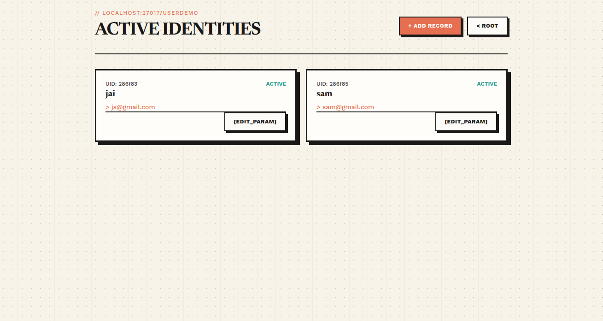

# User Details Management App

A server-rendered user profile management web application built with Node.js, Express, MongoDB, and Tailwind CSS.

---

## 📸 Application Preview



---

## ✨ Features

- Identity records creation, scanning, and updating
- Newspaper / Editorial style layouts compiled with Tailwind CSS
- MongoDB data persistence via Mongoose schemas
- Dynamic EJS page rendering

---

## 🛠️ Tech Stack

- **Runtime:** Node.js
- **Server:** Express.js
- **Database:** MongoDB & Mongoose
- **Views:** EJS
- **Styles:** Tailwind CSS

---

## 🚀 Getting Started

1. Clone the repository:
   ```bash
   git clone <YOUR-REPOSITORY-URL>
   cd express_mongoose